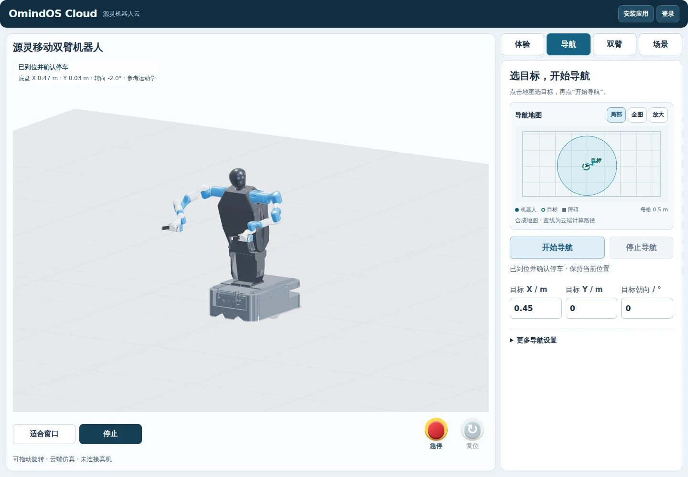
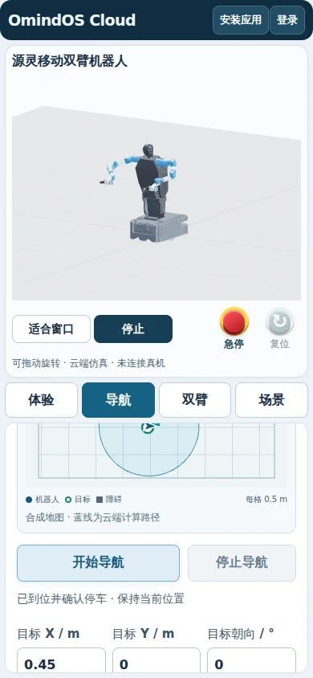
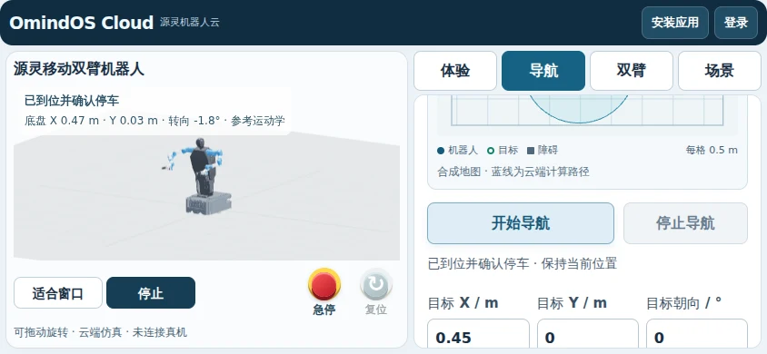

# OmindOS Cloud 导航修复公开发布验收

用户在本任务中明确要求“合并发布”。修复已发布到
[OmindOS Cloud](https://cloud.omindos.cn/)，不是仅部署到受保护候选。
发布时间为 **2026-10-11 21:46:51 UTC / 2026-10-12 05:46:51 北京时间**。

## 合并与发布版本

- [PR #25](https://github.com/Omind-Robotics/OmindOS-Navigation/pull/25)
  先合入 PR #24 分支，依赖合并提交为 `f34c096b329a69e06ef35a06114a0b1e27a69f5c`。
- [PR #24](https://github.com/Omind-Robotics/OmindOS-Navigation/pull/24)
  随后合入 main，公开部署的导航源码提交为
  `99a6d6984204537d9fac7c8ca8d91055184a724f`。
- 合并树为 `d1c3cfe5cd39bb52e5f5a0101da6eb01e6aac02d`，与受保护候选验收
  的 `7785dea0f2e4c3800c1e1d9ea56ff2578fb02b8a` 源码树完全相同。
- PR #24 合并前的新 [源码 CI](https://github.com/Omind-Robotics/OmindOS-Navigation/actions/runs/38177561343)
  与 [浏览器 CI](https://github.com/Omind-Robotics/OmindOS-Navigation/actions/runs/38177561373)
  均成功。源码集合为 robot 83项、workbench 49项；浏览器 CI 使用实际运动学
  fixture。main 未重新触发这两个仅 PR/手动触发的 workflow，不把 PR CI 写成 main 新运行。

只替换三个核心文件：`scripts/robot_navigation.py`、`scripts/robot_workbench.py`、
`web/robot-workbench/workbench.js`，以及应用的 `navigation-ready.js`。
当前线上适配器比仓库旧快照更新，因此保留原适配器，只在原有访客 GET/HEAD
许可中加入 `/v1/navigation-heartbeat/`。心跳仍由现有 RequestRouter 分配到
该访客或登录用户的运行时，不产生跨用户全局任务查询。

没有将旧适配器、候选的全路径登录门、候选 Cookie 或私有缓存作用域覆盖到
公开应用。认证文件与用户数据仍挂载原路径；根文件系统和源代码只读限制
保持。公开首页 SHA256 保持
`ccdff9bbfeb3c452a25ded83d9356a237e36bdf359f876962778dba471a10a3f`。
除导航 readiness 和上述单行适配器许可外，其余30个应用文件哈希保持一致，
包括布局、默认机器人、登录/注册、用户配置、场景、视频和离线缓存脚本。
本次公开发布没有修改 nginx、证书、DNS 或域名跳转。

## 在公开地址执行的真实验收

测试使用实际 HTTPS、Chrome、SwiftShader WebGL、CAD 和后端规划响应，
没有注入位姿或成功结果。导航/故障/资源测试使用新的未登录访客会话；
访问测试另行使用已有授权账号完成真实表单登录，未保存用户配置。

| 验收 | 结果与证据 |
| --- | --- |
| 连续导航 | 桌面1440×1000、手机390×844、横屏844×390各连续3次，9次均到位且确认停车；20/20模型部件加载、零 page_errors；[viewports.json](cloud-navigation-release-20261012/viewports.json) |
| 故障和状态 | 11项通过：3.4秒结果延迟、GET丢失重试、HTML503、10秒读取期限及重试、取消/显式重启、急停/复位、规划拒绝、真实浏览器离线和恢复；状态改变的 POST 没有重复；[faults.json](cloud-navigation-release-20261012/faults.json) |
| 模型资源 | 6项通过：加载期间取消、15秒超时、packed/STL 均不可用时没有导航任务；每种恢复后都要求模型就绪并显式新启动；[assets.json](cloud-navigation-release-20261012/assets.json) |
| 访问与隔离 | 7项通过：访客 Cookie 区分、仅本人心跳200/他人任务与心跳404、他人取消400且原停车结果保持、A急停不影响B、配置写入401/外来Origin403、私有候选401、现有表单登录与授权读取；[access.json](cloud-navigation-release-20261012/access.json) |
| 发布完整性 | 首页、登录、注册及实际静态路由200；服务端组装的访客/授权 workbench.js 均通过语法检查，客户配置脚本仍存在，nginx -t通过；[routes.json](cloud-navigation-release-20261012/routes.json) |

访客 Cookie 继续使用原有 Secure、HttpOnly、SameSite=Lax、Path=/；授权登录
Cookie 继续使用 Secure、HttpOnly、SameSite=Strict、Path=/。外来 Origin 的
心跳403，访客的配置写入401。测试脚本最初误将访客 SameSite 预期写成 Strict；
核对原始适配器后修正为原有 Lax，再完成全部7项。没有为让测试通过改 Cookie。
另一次静态探测误把内联的客户配置脚本当作独立路由，后改为检查实际服务端
组装的 workbench.js；只有最终实际路由结果计入验收。

## 回滚与限制

发布前保留五个原文件和逐文件 before/after SHA256，备份位于
`/opt/omindos-cloud-preview/releases/navigation-20261012-0548`。
[deployment.json](cloud-navigation-release-20261012/deployment.json) 记录发布源码和文件哈希。
`deploy/cloud-preview/release-navigation.py` 先准备与校验，停止原容器后原子替换
这五个文件，启动后检查公开首页和匿名心跳路由。启动或检查失败会还原文件。
`--rollback` 使用同一 manifest，并拒绝覆盖后续产生的文件变动；没有复制或
替换认证文件、客户数据或整个应用目录。此次服务停启操作总耗时7.02秒；
旧的内存任务和会话不会随进程重启续跑，用户可重新登录。没有在公开服务
再次执行回滚停启演练，不能把备份存在写成已经完成生产回滚演练。

可复现的慢结果读取引起的误断线已经修复，并在公开地址通过上述连续操作
与受控故障验收。有限测试不等于长期弱网稳定性承诺。模型15秒准备等待
仍与导航连接租约独立；实际断网仍要求后端停止、手动复位和新启动。

当前服务有访客/用户运行时分配，但这次仅验证两个新访客与现有授权账号。
正式面向多客户承诺服务前，仍需完成多个真实注册账号的越权与存储隔离、
并发规划和配额/容量、长时间弱网/后台休眠/重启恢复、任务关联监控与告警、
回滚演练。这里是几何仿真，实体手机与真实机器人 ROS2/驱动/定位反馈及硬件
急停链路仍需独立验收。故障定位与此前受保护候选证据见
[原验收记录](cloud-navigation-stability-20261012.md)。
