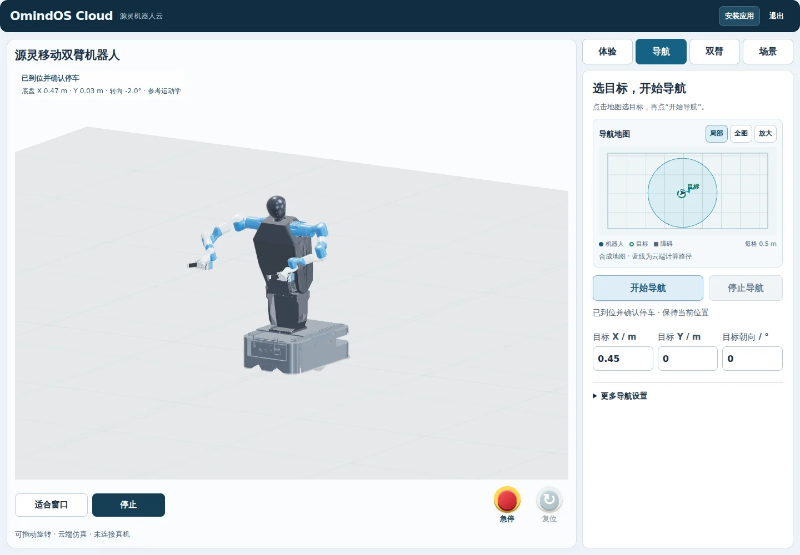
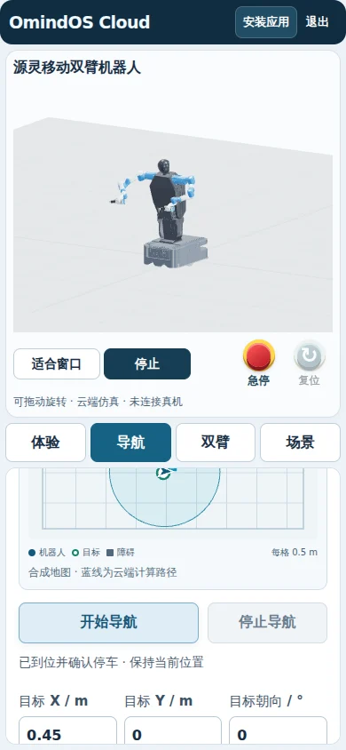
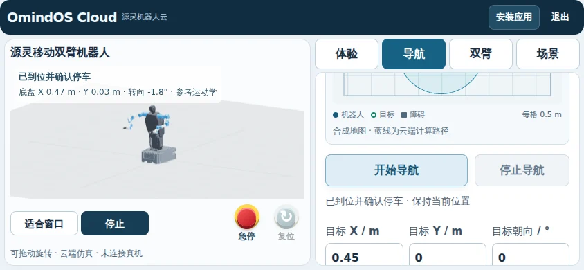

# OmindOS Cloud 导航超时修复与受保护预览验收

后续状态：用户授权“合并发布”后，PR #24/#25 已合并，导航修复已发布到
公开 Cloud。最新公开验收见 [发布记录](cloud-navigation-release-20261012.md)。
下文保留发布之前的故障定位和受保护候选验收范围。

检查始于用户提供的 2026-10-11 开发记录；验收执行时间为2026-10-11 UTC，
服务器本地日期为2026-10-12北京时间（UTC+8），文件名采用服务器本地日期。
代码基于 PR #24 的 `556c6eea520e3ae69e556331236c2d5196cfb8f8`，
没有重做移动端布局。

## 结论与部署范围

已修复可复现的导航连接误停路径：完整任务结果读取延迟不再阻塞独立连接心跳。
修复版在 [受保护导航预览](https://cloud.omindos.cn/_navigation-preview/) 可用，
使用现有授权操作员登录。最终版本9次连续导航、11项故障验收均通过；有限
验收还不能替代长期弱网或正式多用户容量验证。

检查时 `https://omindos.cn/_cloud-preview/` 已经重定向至
`https://cloud.omindos.cn/`。该公开入口已经有访客体验、登录后的配置功能及
访客/用户运行时分配，与 PR #24 的旧单操作员预览记录不同。
此次没有把旧仓库适配器覆盖到现有服务，也没有切换公开入口的代码。
因此，本记录证明修复版受保护预览的行为，不能据此宣称现有公开入口已经换版。

候选容器与原公开容器分开，监听 `127.0.0.1:18889`；只有新增的 HTTPS 子路径
转发至它。候选源代码和模型只读，使用独立空白数据目录，没有复制客户数据。
候选仍使用共享操作员身份，是几何仿真验收环境。原认证文件没有更改，登录
Cookie、浏览器设置和离线缓存使用独立名称/作用域。

## 故障定位依据

核对 PR、实际 API 和可访问容器日志后，发现连接看门狗使用三秒客户租约，
原前端通过串行完整任务结果轮询续租；它同时计算/传输位姿，缺少独立心跳。
历史浏览器验证记录存在“工作台连接中断，导航已停止；未继续双臂操作。”。
容器资产/视频请求的 BrokenPipe、ConnectionReset 不能单独证明导航规划故障。

在实际 Cloud 后端前，将第一份真实任务结果响应额外延迟 3.4 秒：浏览器观测
该请求耗时 4324 ms，任务最终连接中断、停车未确认；同时 12 次独立工作台
状态请求均 HTTP200，最长 746 ms。这复现了连接仍可用时由结果读取等待引起
的错误断线判定。它证明这一故障路径存在，不证明每次历史偶发超时都具有同一
原因。详见 [baseline.json](cloud-navigation-20261012/baseline.json)。

补充代理错误测试还复现了另一处缺口：一次 HTML 格式 HTTP503 结果响应使
旧读取逻辑报 JSON 解析错误，仅读取一次，没有执行允许的瞬时错误重试。
详见 [proxy-error-before.json](cloud-navigation-20261012/proxy-error-before.json)。
修复后的专门浏览器用例要求显式恢复停车且只发送一次 navigation-start。

| 类别 | 实际观测与处理 |
| --- | --- |
| 前端模型等待 | 15 秒资源等待发生在 navigation-start 之前；加载期间取消、等待超时、packed/STL 两种资源都不可用时，导航任务均未创建 |
| 结果读取等待 | 3.4 秒受控响应延迟复现原三秒租约误停；修复版使用独立轻量心跳 |
| 网络连接丢失 | 浏览器真实离线后，前端停止；超过三秒租约后后端停止，速度全零且没有停车确认；恢复网络不自动续跑 |
| 规划/输入异常 | 地图外目标被实际规划器拒绝；随后有效目标可以到位，错误没有混同为连接恢复 |

模型加载器已有 packed 资源失败后回退 STL 的机制。单独中断 packed 请求会
成功恢复模型，因此失败验收同时使 fallback 不可用。资源等待与连接误停是
两个独立机制；本次没有观察到后端规划计算超时作为这一复现的原因，也没有
宣称修复了所有地图/机械臂规划性能问题。

## 实现与安全状态

- 新增 `/v1/navigation-heartbeat/<task_id>`，返回任务状态和运动 epoch，
  不计算整机位姿。前端每 500 ms 独立续租，后端三秒连接停止期限保持不变。
- 任务启动立即返回租约标识；完整结果、心跳和安全状态读取有明确期限，瞬时
  读取失败最多重试一次。代理 HTML 502/503/504 保留 HTTP 状态以支持重试。
  状态改变的 POST 不自动重放，畸形成功响应仍报错。
- 取消/急停中止待处理结果读取；ticket、revision 和 epoch 防止旧结果覆盖新
  状态。终止任务不能被迟到心跳复活。复位只解除停止，必须重新显式启动。
- 保留模型 15 秒等待上限，增加等待后的取消检查与加载失败拒绝。
- 已部署的现代适配器由 `prepare-navigation-preview.py` 检查四个原文件哈希后
  在隔离副本中修改；其输出逐字节匹配候选部署。原公开应用各文件和首页哈希
  另行核对。只有 nginx 子路径 include 被增加，校验配置后 reload。

## 真实验收

浏览器测试使用服务器上的真实 Chrome、WebGL SwiftShader 和真实规划/API
响应；不注入机器人位姿、任务成功状态或虚构规划结果。资源与连接异常是
明确的请求延迟/中断/响应错误注入。桌面与移动设备尺寸使用浏览器视口模拟，
不是实体手机、物理机器人或 GPU 性能验收。环境限制为 1 CPU、768 MiB RAM。

| 验收 | 范围与证据 |
| --- | --- |
| 连续导航 | 1440×1000、390×844、844×390 各连续三次；到位且确认停车，20/20 模型部件成功加载，page_errors 为空；[viewports.json](cloud-navigation-20261012/viewports.json) |
| 故障与状态 | 十一项通过：结果延迟、读取失败、HTML503、读取超时、取消/重启、急停/复位、规划拒绝、离线及恢复；[faults.json](cloud-navigation-20261012/faults.json) |
| 模型资源 | 取消、15秒超时、不可用三种情况均未创建导航任务；每种恢复后都要求重新显式启动，六项通过；[assets.json](cloud-navigation-20261012/assets.json) |
| HTTP 认证 | 九项通过：未登录状态/脚本/心跳/资源401，授权读取200，外来Origin403，文件路径不暴露，原登录可用，公开首页未变；[access-http.json](cloud-navigation-20261012/access-http.json) |
| 浏览器访问隔离 | 四项通过：表单登录保留继承的公开Cookie；真实配置导入只写预览设置；预览SW子路径激活且不删除公开缓存；[access-browser.json](cloud-navigation-20261012/access-browser.json) |
| 现有公开访客隔离 | 两个新访客Cookie运行时中，A急停不影响B；A已复位；公开配置写入仍要求登录。仅此测试不能建立完整租户隔离；[guest-isolation.json](cloud-navigation-20261012/guest-isolation.json) |
| Python 回归 | robot 83项、workbench 49项，合计132项通过；本地 Python3.12、NumPy2.3.5、SciPy1.17.0、trimesh4.11.1 |
| 静态与部署 | 修改的JS语法检查、Python编译、git diff --check通过；nginx -t通过；哈希见 [deployment.json](cloud-navigation-20261012/deployment.json) |

Python检查复用了现有 CI 的两个测试集合。首次 workbench 集合因本地缺少
trimesh 而未通过导入；补齐 CI 固定版本 trimesh4.11.1 后完整49项通过。
开发阶段的离线观察器曾因 GET 自身续租影响测试，已改为完整租约期限内不
轮询，再观察真实停止结果；不把该开发阶段失败记录计作验收通过。

## 正式 Cloud 多用户开放前

1. 以租户身份绑定模型、配置、任务与资产访问，完成多个真实注册账号的
   越权、并发操作与存储隔离测试。两个新访客的初步隔离和共享操作员候选
   均不能替代这项验收。
2. 验证并发规划、排队、取消、配额、资源耗尽与限流；定义可承诺容量和
   响应时间。目前1 CPU/768 MiB及有限连续导航不能建立多客户服务容量。
3. 完成长时间弱网、浏览器后台/休眠、服务重启和任务恢复验收；增加请求/任务
   关联日志、停止原因指标、告警、版本记录和经过演练的回滚。
4. 若面向真实机器人控制，另行验收ROS2/驱动、真实定位与反馈、通信联锁、
   急停与复位的硬件链路。几何仿真停车不是实机安全或动力学证明。

本页所记录的受保护候选验收不构成上述正式开放条件的完成；后续公开发布
也没有完成多客户容量或真实硬件验收，详见发布记录。
