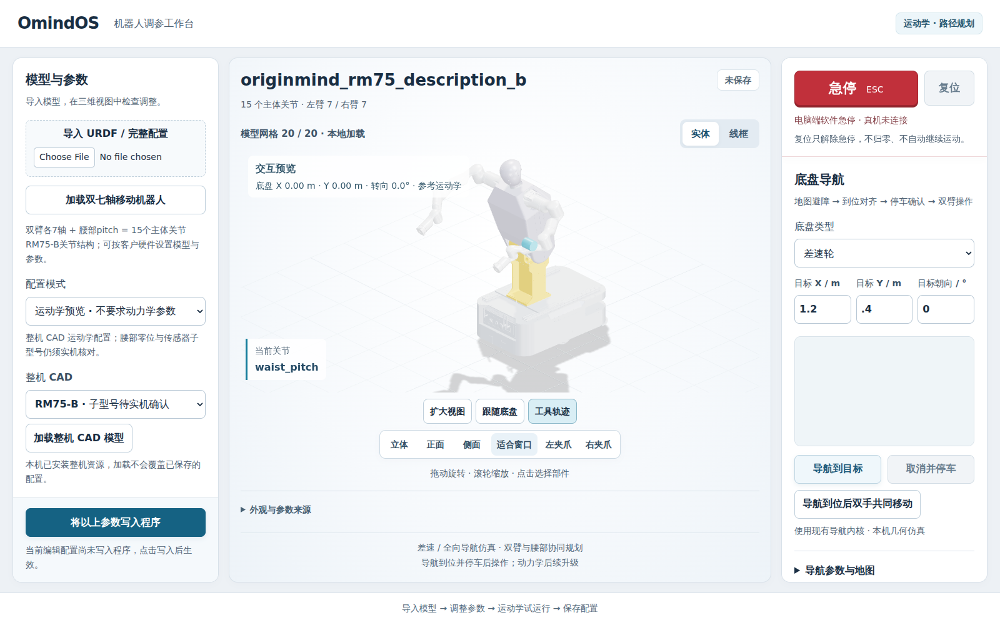

# RM75 单一 Ubuntu 安装版完整 CAD 验收 · 2026-10-10

本记录接续 PR #23 的 19:00 检查点，目标是在已编译并独立解压的安装包上完成真实 CAD 界面门禁。验证范围仍为运动学、路径规划、离散碰撞检查和软件停止。

## 固定交付身份

- 产品源提交：`fdb6813a3d1877be7965a182022cbb1e5c7acb96`。
- 验收脚本提交：`6101e8337522b5de8600de546aafd25ec2590d43`，`scripts/check_rm75_installed.cjs`。
- 脚本 SHA256：`8b2fb94139b823c8c2d92266edb603a3e2b75514ec691ecfee00c289434677f8`。
- 安装归档：`omindos-workbench-0.3.1-rc.1-linux-x64.tar.gz`，87,982,793 字节。
- 归档 SHA256：`f51612e2717e7a9c1fe7cc316ac0b924127fb438a92364beac4a2eacfd666b9f`，本轮重新核对一致。
- 整机资源 manifest SHA256：`cb38efe909587f762e7ad66e408f6de933dfdc87addfdbc0653c36fbf1294cf1`。
- 三种整机型号 B / 6FB / 6F；每种 28 个保守碰撞盒；14 个唯一真实 STL，68,804,176 字节，20 个外观实例。
- Ubuntu 22.04 构建；本轮在 Ubuntu 24.04.4 主机、Google Chrome / SwiftShader 上运行安装版界面。不声称硬件 GPU 帧率验收。

原安装包的独立解压 46 项结果保留在 [候选包记录](rm75-ubuntu-candidate-20261010.json)：17 项基础可执行检查、9 项规划、13 项导航与停车联锁、7 项实际 RM75 资源/API 检查。后端与交付字节本轮未改变，未重复编译。

## 安装版完整 CAD 界面结果

使用独立解压的真实原生可执行程序和实际 CAD，不注入产品状态、不强制点击、不替换小型网格、不关闭产品阴影或放宽 CSP。编译任务结束后单独执行现有完整门禁。原始机器记录：[rm75-installed-browser-20261010.json](rm75-installed-browser-20261010.json)。

| 检查 | 结果 |
| --- | --- |
| 全部 20 个实际外观实例加载，WebGL 上下文有效 | 通过 |
| 实际关节树和 left_tool0 / right_tool0 映射 | 通过 |
| 实际末端聚焦按钮 | 通过 |
| 写入程序，未知物理参数保持 null | 通过 |
| 双臂与腰部的关节目标路径规划及播放 | 通过 |
| 协同演示按钮执行双 TCP 共同位移规划 | 通过 |
| 播放中软件停止、禁用运动、复位后不续跑 | 通过 |
| 390px 手机布局无页面横向溢出 | 通过 |
| 重启后恢复客户配置与全部 20 个网格 | 通过 |

总计 9 项通过，完整测试进程退出码 0，耗时 149.70 秒；页面 JavaScript 错误 0、网格资源失败 0。桌面和手机截图均人工核对：

上页的超时未被当作成功：本轮重新完整执行相同流程，并以实际成功记录关闭剩余门禁。软件渲染的负载较高，仍不宣称所有客户机器上的流畅度或真实 GPU 性能。

## 合并与交付范围

128 项源码回归及原 10 项浏览器回归已在检查点提交通过；本轮新增安装版 9 项完整 CAD 证据，连同独立安装 46 项构成此次合并依据。合并提交前需确认最终文档提交的 GitHub 检查通过。

本记录只收尾并合并开发 PR，公开 v0.3.0 发行附件未替换，候选安装包未公开发布。用户安装方式仍是一个 Ubuntu 包，不需要另装 Python、Node、ROS 或算法包。

未新增动力学、力控、真机驱动、连续碰撞或实物零位标定；实际传感器子型号仍需按硬件选择。28 盒表示保持保守，原相邻关节和刚体结构的碰撞排除规则不变。接口成功和界面演示不扩大为任意双臂搬运任务都可行。
