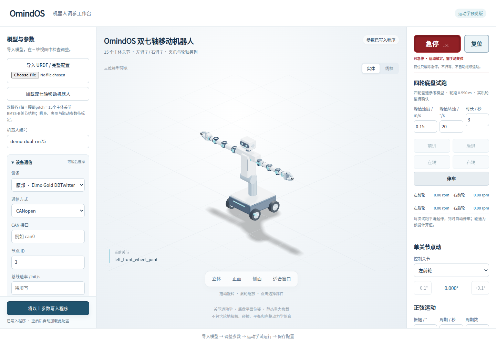

# 设备通信选项验证

日期：2026-10-08。基于已合并 PR #2 的 main `289afcf`；本次只增加可保存的通信草稿，不实现真机适配器，不改变现有模型或四轮参考运动学。

## 实现

- 左右 RM75 分别配置厂家 SDK/TCP、JSON/TCP、JSON/RS-485、JSON/RS232-USB（基础系列）；串口能力仍须核对控制器版本。
- Elmo Gold DBTwitter 提供 CANopen、EtherCAT、RS-232 选项。
- DT-01 Pro 提供底盘 RS-232、导航 MQTT、待确认 Modbus 扩展选项。
- 可先保持“待选择”或留空字段；未选中的草稿也保存，切换回来恢复原值。完整配置导入先校验，避免损坏现有编辑内容。
- `connections` 为可选字段；旧配置的内容和摘要编号不变。新配置使用同一版本保存、读取、导出和当前配置指针，不另建易失的浏览器设置。
- 目录响应明确 `adapter_status=not_integrated`，配置保存不建立连接、不加载 SDK、不发送运动，也不解除急停。没有连接测试或真机执行按钮。

## 结果

Python `python3 -m unittest discover -s tests -q`：43 项通过。新增 5 项覆盖：

1. 旧格式的规范化摘要与读取内容不变。
2. 全部设备/通信选项允许保存未完成草稿。
3. 选中与未选中参数、左右臂独立地址以及切换后的版本在重建服务状态后完整恢复。
4. 隐藏选项中的非法端口、布尔/小数类型、未知字段/方式、控制字符被拒绝。
5. 真实 HTTP 目录、写入和读回；非法导入和写入不覆盖旧配置，急停继续锁住运动接口。

Chromium 153.0.8010.0 / WebGL，1440×1000 及 390×844：38 项通过。原有 33 项关节/底盘/急停检查继续通过，新增 5 项覆盖：

1. 仅浏览通信设备不改变旧配置。
2. 多种方式切换、待选择状态、左右臂独立地址和重载。
3. 无效字段切走后仍阻止保存，清空后可作为待填项。
4. 下载完整 JSON 后重新导入，通信配置不丢失。
5. 急停期间切换并保存通信设置，仍保持急停、无动画、`hardware_connected=false`。

JavaScript 语法和 `git diff --check` 通过。桌面截图已检查；手机仅为浏览器视口验证。

## 资料和范围

用户提供的 DT-01 Pro 文档标注双轮差速及前后脚轮；当前四轮示例不代表客户实际底盘。通信配置不修改 URDF、轮径或轮距。

Elmo 安装手册涵盖多个硬件版本；CANopen/EtherCAT 及 RS-232 电平不能自动确认。RM75 依据厂家公开 JSON 和版本对应文档列出候选选项。设备地址、波特率、固件版本、协议帧/寄存器和 SDK 兼容性仍须在接入实物时核对；本次没有实机验收，也没有重新构建或发布 Windows/Linux 发行包。
