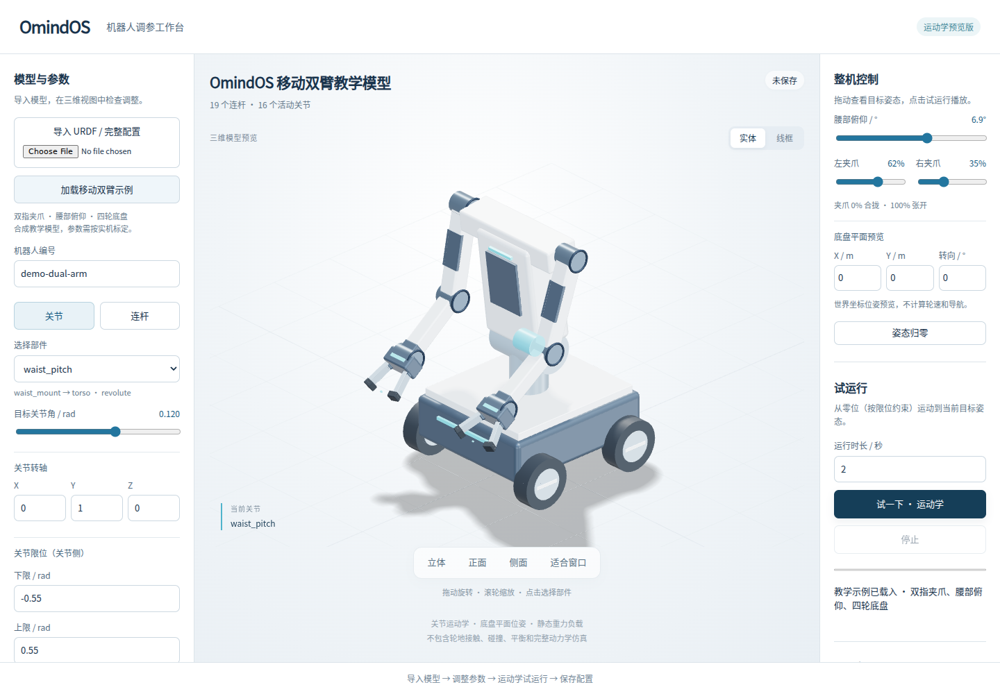

# 三维调参工作台验证记录

2026-10-08；PR #2 基于已合并参数 API 的 main `6c6b7cd` 增量实现。

## 验证结果

- Python `unittest discover -s tests`：24 项通过（原有 13 项、工作台 11 项）。
- 新增解析解检查：1 m 摆杆、2 kg 质心位于 0.5 m、末端固定 1 kg；水平时保持力矩 −19.6133 N·m，绕 +Y 转 90° 后末端为 `[0, 0, −1]`，重力保持力矩接近零。改变连接距离和质量后结果按解析值变化。
- 检查非单位转轴、origin RPY、关节限位、解析峰值速度、传动换算和静态重力超限。
- 实际本机 HTTP：模型解析、轨迹预览、配置保存/读回、旧版本保留及 Host/Origin/Content-Type 限制通过。
- JavaScript 语法检查、Python 编译和 `git diff --check` 通过。

## 浏览器操作验证

运行 `scripts/check_robot_workbench_browser.cjs`，Chromium `153.0.8010.0`，桌面 1440×1000、手机视口 390×844。19 项检查通过：

1. 加载移动双臂教学模型（19 连杆、16 活动关节）。
2. 在界面修改关节连接距离，确认后端计算的下游位置改变。
3. 修改后保存获得不同配置编号。
4. 读取旧编号，恢复原始连接距离。
5. 仅浏览关节/连杆字段不会改变配置内容和版本编号。
6. 运行时长过短导致峰值速度超限，拒绝试跑。
7. 真实运动学轨迹播放到末帧，并显示静态重力结果。
8. 中途停止播放。
9. 空白数值字段阻止保存，不悄悄使用界面中的旧值。
10. 修改连杆质量后，静态重力保持力矩改变。
11. 单独导入 URDF 可显示模型；缺少实际电机参数时不能保存完整配置。
12. 导入完整配置 JSON。
13. 桌面和手机无横向溢出。
14. 手机视口修改目标角并完成试跑。
15. 无浏览器 JavaScript 异常。
16. 腰部 pitch 快捷滑块改变后端实际姿态并选中对应关节。
17. 左夹爪两指同步张开至上限，右夹爪保持不变。
18. 底盘 X 位移及转向进入根连杆变换，与腰部、夹爪及双臂一起完成轨迹播放。
19. 空白底盘输入阻止试跑；姿态归零后恢复可用。

桌面与手机完整页面截图已经检查。手机视口使用 Chromium 缩窄页面检查，尚未做 Android/iOS 实机浏览器验收。浏览器仅为开发验证依赖；工作台运行时不需要 npm/Playwright/Chromium 包。

实体渲染更新：使用本地打包的 Three.js 0.180.0，将线框默认显示改为银灰实体、深色底座、金属关节标记和软阴影；新增实体/线框切换和实体点击选择。原有 15 项浏览器操作检查在 WebGL 模式下重新通过，另已操作检查样式切换、视角旋转，以及禁用 WebGL 后回退兼容线框。展示变更不修改 URDF、质量、惯量或计算结果。用户已明确优先电脑端，手机 App 后续再做。

本次结构更新：保留腰部 yaw，增加 Y 轴 pitch、两组双指铰接夹爪和四个独立轮轴；URDF 带命名材质，质量和惯量为明确的合成示例值。新解析检查确认：基座 `[2,-1,π/2]` 把原位于 `[1,0,0]` 的端点变成 `[2,0,0]`，静态重力力矩保持不变；夹爪张开后两指末端距离增加；腰部俯仰改变手部位姿而不改变底盘和轮子。平面位姿范围、非法颜色、平滑轨迹基座首尾及预览速度限制均通过检查。19 项浏览器操作在 WebGL 模式下通过。

## 交付边界

该验证是**关节运动学、给定底盘平面位姿与静态重力估算**，不是碰撞、平衡、完整动力学或实机验收。底盘位姿没有轮速解算、打滑、轮地接触或导航；不自动联动四个轮轴。Mesh 文件尚不加载，显示关节骨架并提示。惯量、阻尼和摩擦只校验保存，不参与当前运动积分。ROS 2 配置激活、运动控制适配及正式客户发行包仍待完成。本次不修改公开 Release 或标签。
