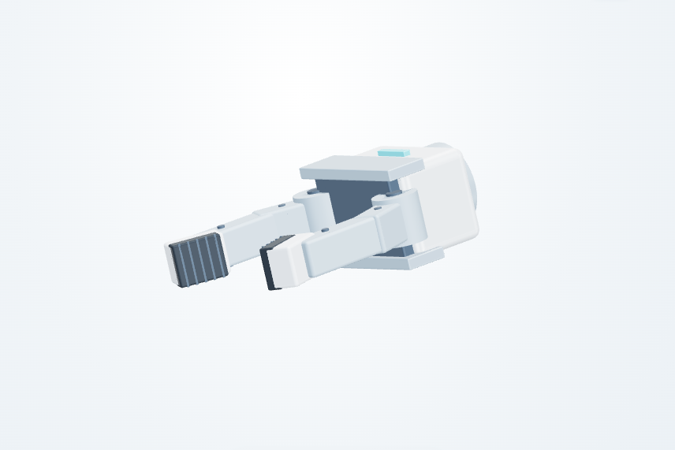

# 三维调参工作台验证记录

2026-10-08；PR #2 基于已合并参数 API 的 main `6c6b7cd` 增量实现。

## 验证结果

- Python `unittest discover -s tests`：38 项通过（原有 13 项、工作台 25 项）。
- 新增解析解检查：1 m 摆杆、2 kg 质心位于 0.5 m、末端固定 1 kg；水平时保持力矩 −19.6133 N·m，绕 +Y 转 90° 后末端为 `[0, 0, −1]`，重力保持力矩接近零。改变连接距离和质量后结果按解析值变化。
- 检查非单位转轴、origin RPY、关节限位、解析峰值速度、传动换算和静态重力超限。
- 实际本机 HTTP：模型解析、轨迹预览、配置保存/读回、旧版本保留及 Host/Origin/Content-Type 限制通过。
- JavaScript 语法检查、Python 编译和 `git diff --check` 通过。

## 浏览器操作验证

运行 `scripts/check_robot_workbench_browser.cjs`，Chromium `153.0.8010.0`，桌面 1440×1000、手机视口 390×844。33 项检查通过：

1. 加载双 RM75-B 七轴模型：15 个主体关节，夹爪与轮轴另列；底层 32 连杆、23 活动关节。
2. 在界面修改关节连接距离，确认后端计算的下游位置改变。
3. 修改后保存获得不同配置编号。
4. 读取旧编号，恢复原始连接距离。
5. 仅浏览关节/连杆字段不会改变配置内容和版本编号。
6. 运行时长过短导致峰值速度超限，拒绝试跑。
7. 真实运动学轨迹播放到末帧，并显示静态重力结果。
8. 中途停止播放。
9. 空白数值字段阻止保存，不悄悄使用界面中的旧值。
10. 修改连杆质量后，静态重力保持力矩改变。
11. 单独导入 URDF 可显示模型；缺少实际电机参数时不能保存完整配置。
12. 导入完整配置 JSON。
13. 桌面和手机无横向溢出。
14. 手机视口修改目标角并完成试跑。
15. 无浏览器 JavaScript 异常。
16. 腰部 pitch 快捷滑块改变后端实际姿态并选中对应关节。
17. 左夹爪两指同步张开至上限，右夹爪保持不变。
18. 底盘 X 位移及转向进入根连杆变换，与腰部、夹爪及双臂一起完成轨迹播放。
19. 空白底盘输入阻止试跑；姿态归零后恢复可用。
20. 左侧写入当前参数，刷新后自动恢复已写入的 URDF 连接距离和质量参数。
21. 单关节点动分别精确增加和减少 0.1°。
22. 首帧时间早于动画开始时间时保持有效姿态，避免负数帧索引。
23. 左臂、右臂、双臂、全身正弦分别选择 7、7、14、15 个主体关节，实际运动后回到起点，夹爪及轮轴全程不变。
24. 播放中急停冻结姿态、锁住控件；后端拒绝运动请求；刷新页面继续保持锁定。
25. 手动解除急停后不自动续跑，新点动可执行。
26. 计算响应延迟返回期间按 Esc 急停，晚到的响应不启动动画。
27. 逐个验证全部 23 个可点动关节：每次正向 0.1°、反向 0.1°，其他关节不变。
28. 急停后不刷新页面直接点击“复位”，保持停止姿态、不归零、不自动续跑；按钮与急停并列。
29. 前进、后退、左转、右转：四轮角度方向与底盘位移/转向一致，其他关节保持不变，结束时轮速显示为零。
30. 行走中停车：底盘和四轮保持当前位置，显示转速归零。
31. 底盘行走中急停：全部方向按钮禁用、接口返回 423；复位后不归零、不自动续跑。
32. 轮速轨迹已计算但响应尚未交给页面时停车或急停：晚到结果不重新启动。
33. 空白或无效的底盘速度输入拒绝启动。

新增后端解析检查覆盖 0.1° 点动及限位拒绝、正弦四分之一周期极值和首尾姿态、未选关节保持、限位振幅缩小、解析峰值速度检查。写入配置后重建服务状态可恢复配置；非法写入不覆盖当前版本，过期解除请求被拒绝。真实 HTTP 并发检查覆盖计算中急停、四个运动接口返回 423，以及解除后使用已写入配置点动。

桌面与手机完整页面截图已经检查。手机视口使用 Chromium 缩窄页面检查，尚未做 Android/iOS 实机浏览器验收。浏览器仅为开发验证依赖；工作台运行时不需要 npm/Playwright/Chromium 包。

实体渲染更新：使用本地打包的 Three.js 0.180.0，将线框默认显示改为银灰实体、深色底座、金属关节标记和软阴影；新增实体/线框切换和实体点击选择。原有 15 项浏览器操作检查在 WebGL 模式下重新通过，另已操作检查样式切换、视角旋转，以及禁用 WebGL 后回退兼容线框。展示变更不修改 URDF、质量、惯量或计算结果。用户已明确优先电脑端，手机 App 后续再做。

结构修正：原教学示例每臂仅三轴，并将夹爪/轮轴计入总数，不能代表用户的双七轴整机。当前改用已有 Manipulation 版本引用的 RM75-B 原始 URDF，左右臂各七轴，加单独腰部 pitch，共十五个主体关节；取消额外腰部 yaw。厂家 URDF 的 origin、axis、limit、mass、inertia 均逐项保持；底盘、机身安装、头部、夹爪和驱动声明仍为未标定参考值。机械臂外形使用简化实体，不加载 STL。

新增后端检查对照随附原始 URDF 验证两条完整七轴链及惯性参数，并确认腰部仅有 pitch、头部为固定关节。点动仍允许辅助关节独立调试；全身正弦只选择十五个主体关节，四个夹爪铰接轴、四个轮轴和底盘世界位姿不参与。关节到达或接近限位会缩小正弦振幅；重力超出参考驱动上限时继续显示原有警告，测试不据此宣称硬件安全。

头部与夹爪外形更新：新增固定头部连杆（颈座、面罩和双镜头外观），随躯干俯仰；夹爪保留原有两指铰接开合，增加安装法兰、电机壳、转轴、弯折手指与带纹理橡胶垫。合成质量、质心与近似惯量随模型一并更新；不表示使用了某款真实夹爪参数。实际桌面与单个夹爪细节截图如下。

## 交付边界

该验证是**关节运动学、给定底盘平面位姿与静态重力估算**，不是碰撞、平衡、完整动力学或实机验收。直接填写底盘位姿仍为独立目标预览；新增四轮试跑通过差速参考运动学联动车轮和底盘，未计算侧滑、轮地接触或导航，未确认实机轮型。Mesh 文件尚不加载，显示关节骨架并提示。惯量、阻尼和摩擦只校验保存，不参与当前运动积分。ROS 2 配置激活、运动控制适配及正式客户发行包仍待完成。本次不修改公开 Release 或标签。

## 四轮联动增量验收

2026-10-08：38 项 Python 测试、33 项 Chromium/WebGL 浏览器检查通过；后端约 3 秒，浏览器完整覆盖已有双七轴控制和新增底盘控件。桌面截图已更新。

新增解析测试覆盖前后退距离与轮周长关系、左右原地转向、非零初始朝向、圆弧轨迹、轮径/轮距/反向轮轴对角速度的影响、峰值轮速约束、预览范围拒绝、配置写入及服务重建后恢复。测试默认采用半径 0.1 m、轮距 0.59 m 的四轮差速参考模型；2 秒、峰值 0.2 m/s 的平滑速度脉冲前进 0.2 m，四轮各转 2 rad；2 秒、峰值 0.4 rad/s 的原地左转使底盘转 0.4 rad，左轮 −1.18 rad、右轮 +1.18 rad。

浏览器延迟响应测试使用显式等待/释放，保证服务器成功算出的轨迹在停车/急停后才抵达，避免原先定时等待结束时路由仍未完成的测试竞态。停车与急停均取消尚未返回的动作；软件急停仍仅覆盖本机预览。
